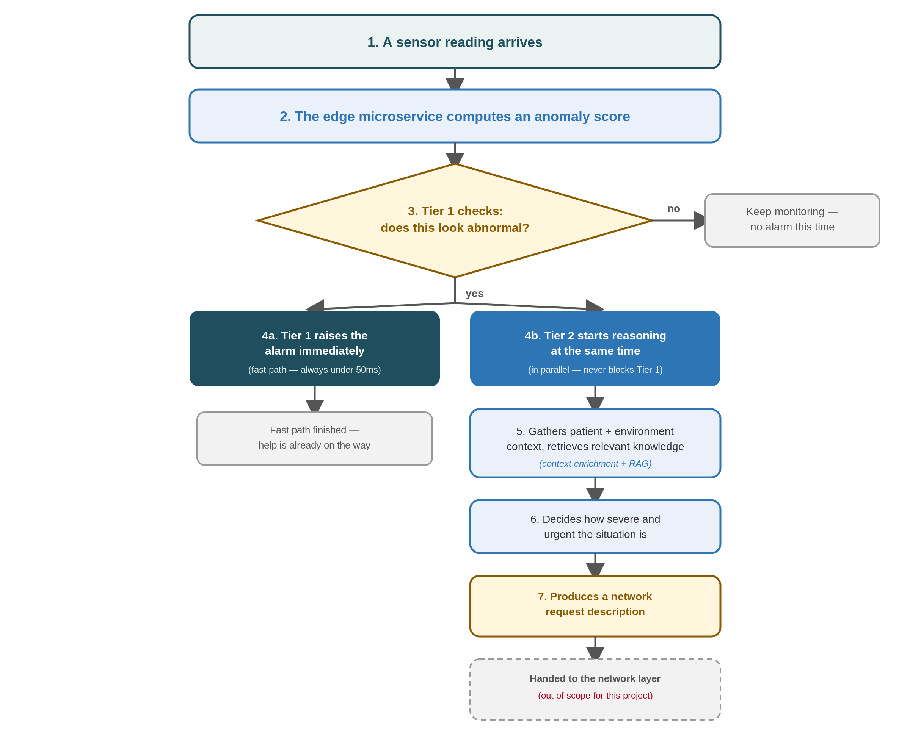
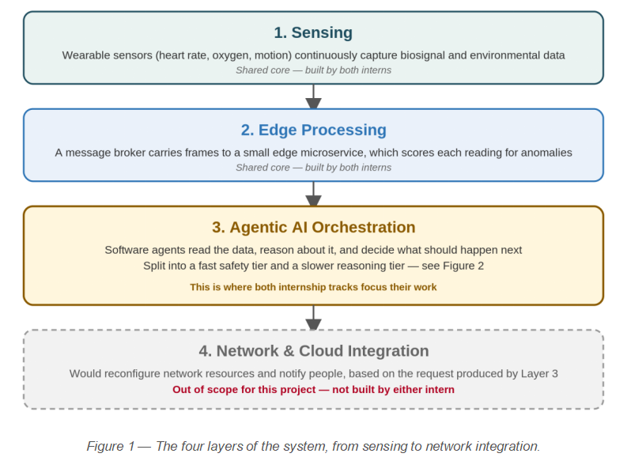
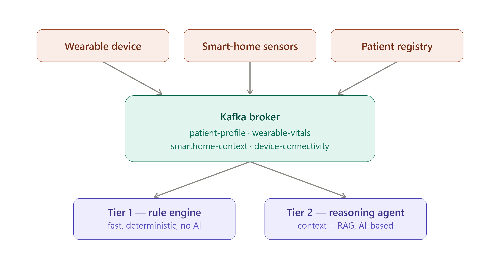
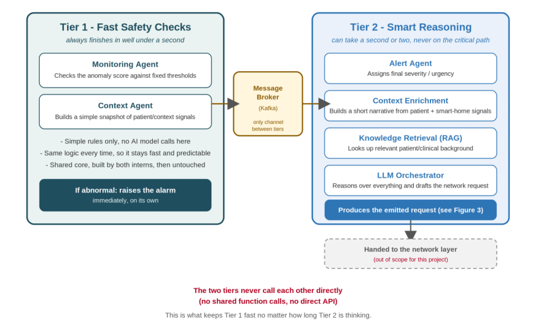
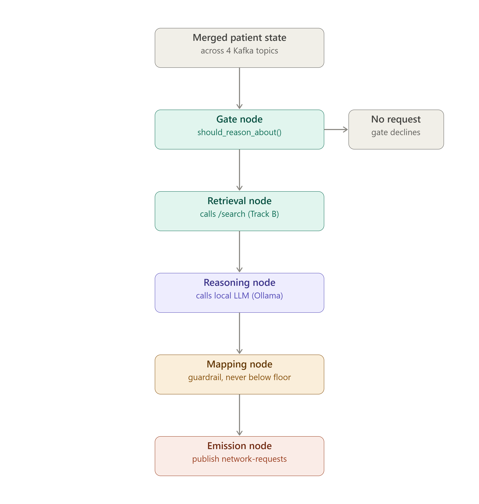

# Kafka Multi-Agent Medical Monitoring System

This repository implements a Kafka-based patient-monitoring platform for home-care and assisted-living scenarios. The flow starts with streaming sensor inputs, continues through fast Tier 1 safety checks, and then escalates to a slower Tier 2 reasoning and retrieval layer when a situation requires richer context or interpretation.

This project is designed as both an implementation and a research artifact. It includes the runtime architecture, benchmark runners, measured results, generated figures, and documentation that can be reused in a report or appendix.

## Repository map

- [docs/kafka/](docs/kafka/) — Kafka topic creation, fixture replay, and sensor simulation
- [tiers/](tiers/) — Tier 1 deterministic safety logic
- [TrackA/](TrackA/) — Tier 2 reasoning layer and framework comparison
- [TrackB/](TrackB/) — retrieval service, benchmark scripts, evaluation, and measured results
- [docs/](docs/) — report figures and supporting documentation assets
- [docker-compose.yml](docker-compose.yml) — local Kafka broker setup
- [requirement.txt](requirement.txt) — Python dependency list

Detailed sub-readmes:

- [TrackA/README.md](TrackA/README.md)
- [TrackB/README.md](TrackB/README.md)
- [Implementation status and DOCX requirement map](docs/implementation_status.md)
- [Track A final report](TrackA/FINAL_REPORT.md)
- [Track B final report](TrackB/FINAL_REPORT.md)

---

## Executive summary

The system is organized in two processing tiers:

1. Tier 1 performs fast, deterministic safety evaluation.
2. Tier 2 adds context-aware reasoning and retrieval when weak signals, ambiguous conditions, or missing context complicate a patient event.

The design is not trying to replace clinical judgment with a single monolithic model; it is trying to create a practical home-monitoring pipeline that:

- reacts quickly when a patient is in an obvious danger zone,
- uses retrieval and reasoning only when needed,
- keeps a deterministic safety floor in place,
- produces a structured network request rather than taking action itself.

This architecture intentionally balances speed, safety, and transparency.

---

## System purpose

The project models a patient-monitoring environment in which sensor events and smart-home context are routed through Kafka and processed by multiple layers.

The core objectives are:

- ingest wearable, smart-home, and connectivity data
- detect clear-risk conditions immediately
- reason about more ambiguous scenarios
- fetch patient-specific context using retrieval
- attach a severity and urgency assessment
- produce a network request that describes the required connection quality and urgency

The project does not directly reconfigure network services, notify hospitals, or trigger real emergency workflows. It stops at generating a valid request artifact.

---

## Architecture overview

### Tier 1: fast safety layer

Tier 1 is the immediate-response layer. It reads alarm-producing inputs such as abnormal heart rate, low oxygen saturation, or fall detection and emits a fast, deterministic risk decision.

This layer is intentionally simple and human-auditable. It is not trying to infer intent; it is trying to enforce a stable safety threshold.

Its thresholds come from the same rule table (`TrackA/shared/rules.json`) that the Tier 2 guardrail uses as its floor, so the two tiers cannot disagree. Physically impossible readings (heart rate 0, SpO2 above 100) are flagged as a sensor fault to verify. The first alarm of an episode, any escalation and any new cause are published immediately; an unchanged condition is repeated every 30 seconds instead of on every reading.

### Tier 2: reasoning and retrieval layer

Tier 2 sits behind Tier 1 and reasons only when the situation deserves a deeper look. It combines:

- current patient state
- patient history and document snippets from retrieval
- a local reasoning model
- a deterministic rule table for safety floor enforcement
- a final network-request artifact

This is covered in detail in [TrackA/README.md](TrackA/README.md).

### Track B: retrieval and benchmarking

Track B is responsible for the retrieval layer. It evaluates which vector database best supports patient-aware retrieval with metadata filters and production-style persistence.

This is covered in detail in [TrackB/README.md](TrackB/README.md).

---

## End-to-end workflow

The system works as a message-driven pipeline.



### High-level flow

1. Kafka receives sensor and context events.
2. Tier 1 processes current patient state.
3. Tier 2 decides whether deeper reasoning is needed.
4. Retrieval fetches relevant patient information.
5. The local reasoning model produces a judgment.
6. The guardrail keeps the decision from dropping below the rule-table floor.
7. A network-request object is emitted if the final severity warrants it.

---

## Four-layer system view

The project can also be understood as a four-layer system design.



These layers are:

- sensor and event input
- event transport and buffering
- tiered reasoning and rule evaluation
- support-request generation

---

## Kafka and topic model

The project uses Kafka to carry patient-monitoring events across the components. The topic model is designed to separate sensor readings from alerts and maintenance-style events.



The system listens on topics including:

- wearable-vitals
- smarthome-context
- device-connectivity
- patient-profile
- patient-context
- alarms
- network-requests

The message broker is started from [docker-compose.yml](docker-compose.yml).

---

## Tier 1 and Tier 2 architecture



This diagram shows the separation between:

- rule-based immediate alarms,
- contextual reasoning and retrieval,
- final severity mapping and output publication.

---

## Tier 2 real pipeline flow



This is the actual production-style flow used in Track A:

- incoming patient state is assembled (and rebuilt from Kafka after a restart)
- a cheap gate decides whether to reason; an unchanged situation is not reasoned about twice, and reasoning runs on a worker pool so it never blocks event intake
- retrieval fetches context
- the reasoning model is called once
- the guardrail enforces safety rules
- the network request is created and published

---

## How the System Decides What Matters

Once Tier 2 has reasoned about a situation, it translates that judgment into two things: how severe or urgent it is, and what kind of network support that would call for.

The mapping used in the project is intentionally straightforward:

| Severity | What it generally means | What we ask the network for |
| --- | --- | --- |
| Critical | Life-threatening or rapidly worsening | A dedicated, guaranteed low-latency connection |
| High | Requires prompt attention | A dedicated but less strict connection |
| Moderate | Worth a closer look, not an emergency | A good-quality shared connection |
| Normal | Nothing abnormal detected | No special request |

This means the output is not a direct action; it is a structured support request describing the type of network quality the system would want if a real response path were activated.

---

## The scenarios used for evaluation

The same fixed set of scenarios is used across the system so the behavior can be tested and compared honestly.

### 8.1 Core scenarios

| ID | Situation | What should happen |
| --- | --- | --- |
| S1 | Irregular heartbeat + fall detected + low oxygen reading + patient elderly and alone | Classified as very severe; the system should request a dedicated, low-latency connection |
| S2 | All readings within normal range, nothing unusual | No alarm; no network request produced |
| S3 | Unusually slow heart rate, no other risk factors present | Classified as moderate; a good-quality but non-emergency connection is requested |

### 8.2 Context-enriched, deliberately ambiguous scenarios

| ID | Situation | What should happen |
| --- | --- | --- |
| S4 | No single reading crosses an alarm threshold, but three weak signals combine: mild heart-rate elevation, a hot room, and a missed medication dose, patient alone | Should raise a “watch closely” flag — a case a simple rule table would likely miss entirely |
| S5 | Heart-rate spike, an unanswered check-in, and a loud noise picked up by a smart speaker — but the fall sensor itself did not trigger | Should still be treated as a likely fall, by combining evidence the fall sensor alone would have missed |
| S6 | An alarm-level reading arrives at the same moment the wearable's connection briefly drops | The alarm still goes out immediately and unmodified — but the system can attach a note asking for a quick confirmation, since the drop makes the reading slightly less certain |

These scenarios are encoded in [docs/kafka/scenarios.json](docs/kafka/scenarios.json) and used in the benchmark and system validation flow.

The first three scenarios verify the basic pipeline. The last three exist to show why a reasoning tier is useful: each one contains a pattern that a fixed threshold table either misses or handles too bluntly.

---

## What is in scope vs. out of scope

### In scope

- sensor replay setup
- Kafka event flow
- Tier 1 alarm logic
- Tier 2 reasoning and retrieval
- severity and urgency mapping
- producing the network-request description

### Out of scope

- actually reconfiguring real network infrastructure
- real emergency dispatch or notification
- real smart-home hardware integration
- live hospital or clinical action workflows

The project intentionally stops at producing a well-formed support request instead of acting on it.

---

## Track A: reasoning architecture and framework decision

The main architectural comparison happens in [TrackA/README.md](TrackA/README.md) and the concise handoff is in [TrackA/FINAL_REPORT.md](TrackA/FINAL_REPORT.md).

### Reasoning framework comparison

The Track A evaluation compares three orchestration frameworks plus a dependency-free native baseline (LangGraph, AutoGen, CrewAI, lightweight native pipeline) on identical mocked stage costs: one warm-up pass, then 30 timed repeats of the six scenarios per candidate. Orchestration overhead, from [TrackA/benchmark/results.json](TrackA/benchmark/results.json):

| Candidate | Full pipeline: median overhead (ms) | P95 (ms) | Gate declined: median overhead (ms) |
| --- | ---: | ---: | ---: |
| Lightweight native | 1.31 | 1.96 | 0.18 |
| AutoGen | 3.67 | 4.95 | 0.15 |
| LangGraph | 6.63 | 7.92 | 2.16 |
| CrewAI | 649.84 | 710.19 | 637.19 |

LangGraph, AutoGen and the native pipeline all add a few milliseconds, which is negligible next to a model call of about 3 s. CrewAI adds about 0.65 s per event even with an instant stub model, and would add ten extra model calls per event against a real one. The project chooses LangGraph for its explicit state graph and conditional edges; the benchmark rules out CrewAI but does not separate LangGraph from AutoGen or the native pipeline.

### Rule table versus the real model

The ablation runs the real pipeline with `qwen2.5:3b` and the live retrieval service, five times per scenario ([TrackA/docs/ablation_results.csv](TrackA/docs/ablation_results.csv)):

| Scenario | Rule table | Model's raw answer (5 runs) | Final after guardrail | Designed outcome | Result |
| --- | --- | --- | --- | --- | --- |
| S1 | critical | high x5 | critical x5 | critical | Model under-rated it; the guardrail kept the critical floor |
| S2 | normal | not called (gate declined) | normal x5 | normal | As designed, no model call |
| S3 | moderate | high x5 | high x5 | moderate | Over-escalated in every run |
| S4 | normal | high x5 | high x5 | moderate | Escalated as intended, but one level too far |
| S5 | moderate | high x5 | high x5 | high | As designed |
| S6 | high | high x5 | high x5, confidence `uncertain_connectivity_drop` | high | As designed |

The safety floor works: in S1 the model under-rated a fall with low oxygen as "high" and the guardrail kept it critical. The model itself answered "high" in all 25 calls, so with this model the reasoning tier over-escalates (S3, S4) more than it discriminates. See [TrackA/README.md](TrackA/README.md) for the full discussion.

---

## Track B: retrieval architecture and database decision

The main retrieval benchmark and comparison are in [TrackB/README.md](TrackB/README.md).

### Vector-store benchmark results

FAISS and Chroma are measured in-process; Qdrant is the Docker server, over gRPC. Median query latency from [TrackB/docs/results.csv](TrackB/docs/results.csv) (the full table, including REST and P95, is in [TrackB/README.md](TrackB/README.md)):

| Corpus | Workload | FAISS flat (ms) | Chroma (ms) | Qdrant gRPC (ms) |
| ---: | --- | ---: | ---: | ---: |
| 1,000 | unfiltered | 0.52 | 1.05 | 2.59 |
| 1,000 | `patient_id` filter | 0.05 | 1.95 | 2.69 |
| 10,000 | unfiltered | 5.18 | 1.77 | 2.93 |
| 10,000 | `patient_id` filter | 0.13 | 13.13 | 2.48 |
| 50,000 | unfiltered | 3.50 | 1.62 | 5.28 |
| 50,000 | `patient_id` filter | 0.26 | 61.46 | 2.57 |

Without a filter, 93-97% of the documents returned for a patient query belong to a different patient, in every store; with the filter, leakage is 0 and the patient's documents are always returned.

### Why Qdrant is chosen for the real-world implementation

FAISS is the fastest when the application maintains its own patient-to-rows map, but Qdrant is selected as the production fit because its filtered latency stays flat as the corpus grows and it provides:

- native payload filtering by patient and metadata fields
- service-based deployment with persistence
- straightforward operational scaling
- a better fit for real patient-scoped document retrieval

The comparison file [TrackB/docs/comparison.csv](TrackB/docs/comparison.csv) classifies Qdrant as the best choice for the medical system.

The actual service is implemented in [TrackB/retrieval_service.py](TrackB/retrieval_service.py).

---

## RAGAS vs DeepEval

Both frameworks scored the same seven question/context/answer cases with the same local judge (`qwen2.5:3b` through Ollama), one metric at a time. All 7 cases produced a valid score for every metric in both frameworks.

| Metric | RAGAS 0.4.3 | DeepEval 4.2.8 | RAGAS time (s) | DeepEval time (s) |
| --- | ---: | ---: | ---: | ---: |
| Faithfulness | 0.93 | 0.54 | 49.0 | 61.6 |
| Answer relevancy | 0.61 | 0.74 | 14.7 | 42.6 |
| Context precision | 0.88 | 1.00 | 52.1 | 28.4 |
| Context recall | 0.86 | 0.67 | 24.4 | 24.1 |
| **Total** | | | **140.2** | **156.7** |

What this run supports:

- **The two frameworks do not agree.** With identical inputs and the same judge, the per-metric averages differ by 0.12 to 0.39. The frameworks ask the judge different questions (different prompts and claim-extraction steps), and a 3B-parameter judge answers them inconsistently.
- **The scores are not stable enough to rank anything.** Between two consecutive runs of this script, the faithfulness score of the first case moved from 0.0 to 0.5 in RAGAS and from 1.0 to 0.0 in DeepEval. With seven cases, one flipped case moves an average by 0.14.
- **Neither framework is meaningfully faster.** Total time was 140 s for RAGAS and 157 s for DeepEval; both are dominated by local judge calls.
- The same model generates the answers and judges them, and the references are keyword phrases rather than full answers, so the reference-based metrics are approximate.

Conclusion: this experiment does not justify choosing one framework over the other. Either can be driven by a local judge; a trustworthy quality number needs a larger labelled query set and a stronger, independent judge model. Retrieval quality is therefore reported with the label-based metrics of the vector-store benchmark (Recall@3, cross-patient leakage), which need no judge model.

Earlier versions of this repository reported near-identical RAGAS and DeepEval scores and a 10x speed advantage for RAGAS. Those RAGAS figures were not measured (the RAGAS run had returned no scores) and have been removed; the table above replaces them. Per-case scores are in [TrackB/evaluation/results_eval_cases.csv](TrackB/evaluation/results_eval_cases.csv).

Summary rows: [TrackB/evaluation/results_eval_frameworks.csv](TrackB/evaluation/results_eval_frameworks.csv).

---

## Benchmark and report figures

The project includes the generated figures from the vector-store benchmark, all stored under [TrackB/docs/figures](TrackB/docs/figures):

- [fig1_latency_vs_corpus_size.png](TrackB/docs/figures/fig1_latency_vs_corpus_size.png)
- [fig2_index_time_vs_corpus_size.png](TrackB/docs/figures/fig2_index_time_vs_corpus_size.png)
- [fig3_percentile_comparison.png](TrackB/docs/figures/fig3_percentile_comparison.png)
- [fig4_latency_distribution_boxplot.png](TrackB/docs/figures/fig4_latency_distribution_boxplot.png)
- [fig5_filtered_latency_vs_corpus_size.png](TrackB/docs/figures/fig5_filtered_latency_vs_corpus_size.png)
- [fig6_retrieval_quality.png](TrackB/docs/figures/fig6_retrieval_quality.png)

Related benchmark appendix:

- [TrackB/docs/appendix_A.md](TrackB/docs/appendix_A.md)
- [TrackB/docs/comparison.csv](TrackB/docs/comparison.csv)
- [TrackB/docs/results.csv](TrackB/docs/results.csv)

---

## Operational notes and deployment fit

### Install effort (hours)

- Track A framework comparison: around 1–2 hours to establish the setup and run benchmarks
- Track B retrieval environment: around 1–3 hours depending on whether the developer needs to install vector DB tooling and local evaluation dependencies
- RAGAS vs DeepEval: similar setup cost and similar run time (about 2.5 minutes each for seven cases with a local judge)

### Runs on target env. (edge HW / cluster)

This system is designed for a practical deployment range that includes:

- local or edge-based gateway nodes,
- a central processing layer,
- Docker-based development and test clusters,
- a service-based vector database backend such as Qdrant.

Qdrant is the best fit for both a modest local deployment and a future cluster-style deployment because it behaves like a real service rather than a simple embedded library.

### Key metrics produced

The project produces the following metrics:

- retrieval latency by store and corpus size, with and without a `patient_id` filter
- Recall@3 and cross-patient leakage on labelled queries
- indexing time
- p50 / p95 / p99 / max latency
- judge-based quality scores from RAGAS and DeepEval
- framework overhead comparison for Track A orchestration options
- rule-table versus real-model severity for each scenario
- patient-event and network-request results from the scenario replay

### Maps to project needs

| Need | Best match | Why |
| --- | --- | --- |
| Fast alarm processing | Tier 1 + deterministic rules | Lowest latency and highest explainability |
| Ambiguous patient state interpretation | LangGraph + retrieval + LLM | Good state flow and low orchestration overhead |
| Patient-scoped retrieval | Qdrant | Native metadata filtering and proper service model |
| Reproducible evaluation | Label-based Recall@3 and leakage | Needs no judge model; RAGAS and DeepEval disagreed with a small local judge |
| Safe deployment behavior | Guardrails and rule-table floor | Prevents unsafe downgrade of risk severity |

### Fit as-is / needs adaptation

- Track A as-is: good fit for the current event-driven architecture
- Track A with broader multi-agent delegation: possible but not necessary for the current problem
- Track B as-is: strong fit for the current retrieval layer and patient-specific filtering
- Qdrant in larger production clusters: requires deployment adaptation, but not a redesign

---

## Quick start

### Start Kafka and Qdrant

```powershell
docker compose up -d kafka qdrant
```

### Create Kafka topics

```powershell
python docs\kafka\Create_topics.py
```

### Run Tier 1

```powershell
python -m tiers.tier1_agent
```

### Run Tier 2

```powershell
python -m TrackA.tier2_agent
```

### Start retrieval service

```powershell
python -m uvicorn TrackB.retrieval_service:app --host 127.0.0.1 --port 8000
```

### Replay scenarios

```powershell
python docs\kafka\Fixtures.py --patient P001 --scenario S1
```

### Run smoke checks

```powershell
python TrackB\test_retrieval_service.py
```

### Generate benchmark figures

```powershell
python TrackB\retrieval\plot_benchmark.py
```

---

## Final conclusion

This repository is best understood as a two-track system:

- Track A chooses a reasoning architecture that is explicit, low-overhead, and safe.
- Track B chooses a retrieval backend that is operationally strong rather than merely the fastest in a microbenchmark.

The evidence supports the following decisions:

- LangGraph is the orchestration framework for Tier 2. Its overhead (about 7 ms) is negligible; so is AutoGen's and the native pipeline's, and CrewAI's is not.
- The deterministic guardrail is what makes the reasoning tier safe: with the tested local model it prevented an under-rated critical case, while the model itself over-escalated.
- Qdrant is the retrieval backend, because patient-scoped retrieval requires a filter and Qdrant's filtered latency stays flat as the corpus grows.
- The RAGAS/DeepEval comparison is inconclusive with a small local judge and seven cases; retrieval quality is tracked with label-based metrics instead.

What is not yet shown: that the chosen local model adds useful discrimination, that the results hold beyond one machine and a synthetic corpus, and how long an event takes end to end through the live Kafka broker (the full stack has been run as a smoke check only).

For the detailed Track A and Track B breakdowns, see:

- [TrackA/README.md](TrackA/README.md)
- [TrackB/README.md](TrackB/README.md)

