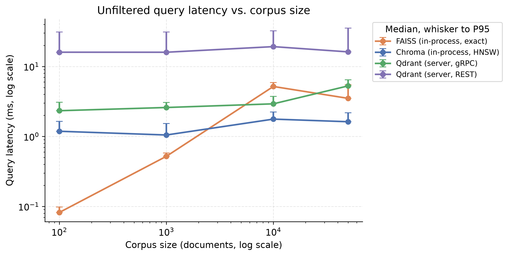
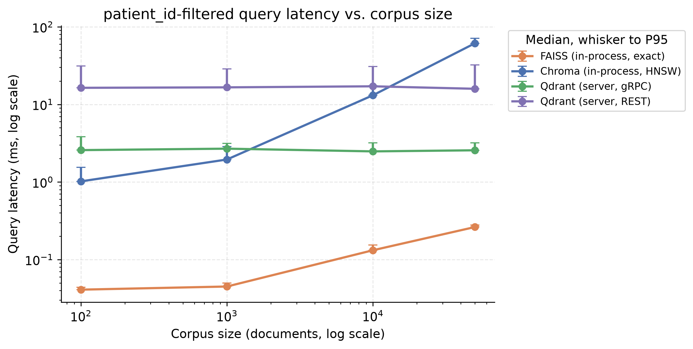
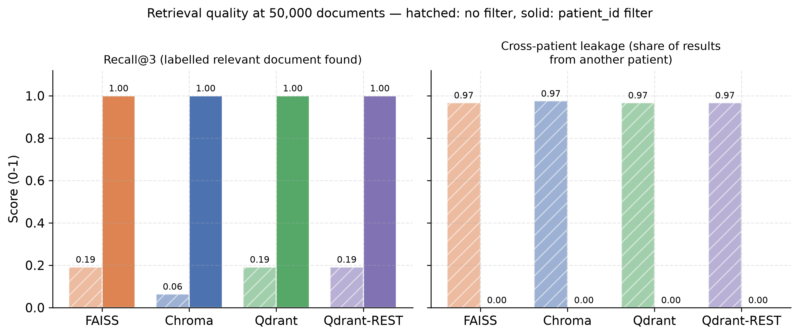
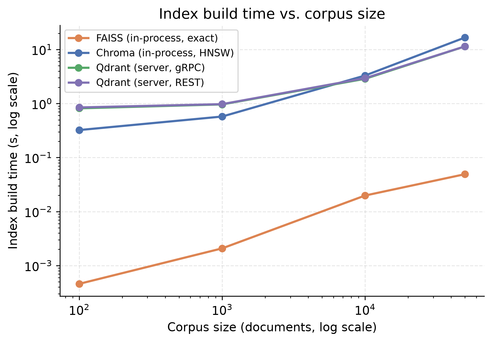
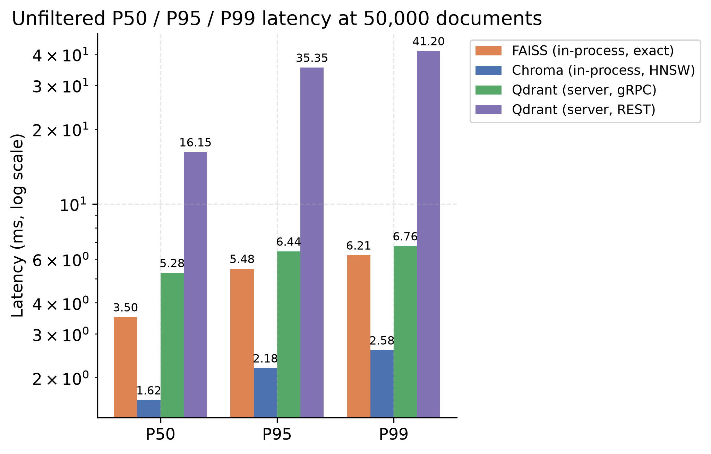
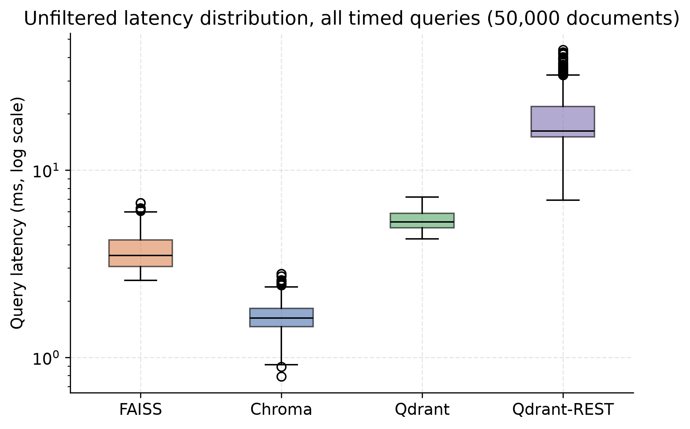

# Track B: Retrieval Layer Benchmark and Real-World Selection

## Executive summary

Track B evaluates the retrieval layer that feeds the Tier 2 reasoning system with patient-specific medical context. The goal was not simply to find the absolute fastest vector index, but to pick the store that best balances:

- query speed
- indexing cost
- persistence and operational stability
- metadata filtering by `patient_id` and other payload fields
- deployment fit for a real service
- clean integration with a local LLM-driven workflow

The benchmark shows why: patient-scoped retrieval is only correct with a `patient_id` filter, and Qdrant is the store whose filtered latency stays flat (about 2.5 ms over gRPC) from 100 to 50,000 documents while running as a persistent service. An in-process FAISS index is faster, but leaves filtering, persistence and the service boundary to application code.

For the final requirement map and residual work, see [FINAL_REPORT.md](FINAL_REPORT.md) and [../docs/implementation_status.md](../docs/implementation_status.md).

## What this Track does

Track B contains the retrieval infrastructure used by the medical monitoring system:

- a document corpus for patient facts and clinical notes
- vector-store benchmarking for Chroma, FAISS, and Qdrant
- a FastAPI retrieval service backed by Qdrant
- an evaluation script that scores the same cases with RAGAS and DeepEval
- raw benchmark outputs and report-ready figures

The practical requirement is retrieval that can return patient-scoped context reliably and safely, not just the fastest nearest-neighbor lookup in a one-off benchmark.

## Benchmark setup

The benchmark compares FAISS, Chroma and Qdrant on a seeded synthetic corpus of 100, 1,000, 10,000 and 50,000 documents with the same embedding model (`all-MiniLM-L6-v2`), `top_k = 3`, and at least 300 timed searches per configuration.

- FAISS (exact flat index) and Chroma (HNSW) run in-process. Qdrant is the **server** from `docker-compose.yml` (version 1.18.3), measured over gRPC and over REST. The Python `:memory:` mode of qdrant-client is not used.
- Two workloads are timed: **unfiltered** search over the whole corpus, and search **filtered to one patient** with each store's own mechanism.
- Every query is labelled with the documents that answer it, so Recall@3 and cross-patient leakage are measured, not assumed.

Full method: [docs/experiment_protocol.md](docs/experiment_protocol.md). Aggregates: [docs/results.csv](docs/results.csv). Every latency sample: [docs/raw_latencies](docs/raw_latencies). Machine and versions: [docs/benchmark_environment.json](docs/benchmark_environment.json).

## Measured vector-store results

| Store (deployment) | Corpus | Index build (s) | Unfiltered P50 / P95 (ms) | `patient_id`-filtered P50 / P95 (ms) |
| --- | ---: | ---: | ---: | ---: |
| FAISS flat (in-process) | 100 | 0.0005 | 0.08 / 0.10 | 0.04 / 0.04 |
| Chroma (in-process) | 100 | 0.32 | 1.19 / 1.65 | 1.02 / 1.55 |
| Qdrant (server, gRPC) | 100 | 0.82 | 2.33 / 3.08 | 2.58 / 3.82 |
| Qdrant (server, REST) | 100 | 0.85 | 15.98 / 31.05 | 16.38 / 31.24 |
| FAISS flat (in-process) | 1,000 | 0.002 | 0.52 / 0.58 | 0.05 / 0.05 |
| Chroma (in-process) | 1,000 | 0.57 | 1.05 / 1.53 | 1.95 / 2.86 |
| Qdrant (server, gRPC) | 1,000 | 0.96 | 2.59 / 3.07 | 2.69 / 3.15 |
| Qdrant (server, REST) | 1,000 | 0.98 | 15.96 / 31.16 | 16.61 / 28.80 |
| FAISS flat (in-process) | 10,000 | 0.02 | 5.18 / 5.89 | 0.13 / 0.15 |
| Chroma (in-process) | 10,000 | 3.30 | 1.77 / 2.24 | 13.13 / 17.52 |
| Qdrant (server, gRPC) | 10,000 | 2.87 | 2.93 / 3.73 | 2.48 / 3.21 |
| Qdrant (server, REST) | 10,000 | 2.95 | 19.21 / 32.38 | 17.13 / 30.84 |
| FAISS flat (in-process) | 50,000 | 0.05 | 3.50 / 5.48 | 0.26 / 0.28 |
| Chroma (in-process) | 50,000 | 16.70 | 1.62 / 2.18 | 61.46 / 71.24 |
| Qdrant (server, gRPC) | 50,000 | 11.43 | 5.28 / 6.44 | 2.57 / 3.20 |
| Qdrant (server, REST) | 50,000 | 11.46 | 16.15 / 35.35 | 15.91 / 32.35 |

Retrieval quality (identical for FAISS and Qdrant, which both searched exactly; Chroma differs where noted):

| Corpus | Workload | Recall@3 | Cross-patient leakage | Chroma ANN recall vs exact |
| ---: | --- | ---: | ---: | ---: |
| 100 | unfiltered | 0.26 | 0.93 | 1.00 |
| 1,000 | unfiltered | 0.21 | 0.96 | 1.00 |
| 10,000 | unfiltered | 0.21 (Chroma 0.15) | 0.93 | 0.93 |
| 50,000 | unfiltered | 0.19 (Chroma 0.06) | 0.97 | 0.73 |
| all sizes | `patient_id` filter | 1.00 | 0.00 | 1.00 |

### Interpretation

- **Without a filter, patient retrieval does not work.** For a query that names a patient, 93-97% of the returned documents belong to a different patient, in every store. The embedding model cannot tell `P00412` from `P00421`; unfiltered Recall@3 of about 0.2 is carried almost entirely by the seven general-knowledge queries. Filtering is a correctness requirement here, not a convenience.
- **With the filter, Qdrant's latency does not grow with the corpus**: about 2.5 ms median over gRPC from 100 to 50,000 documents. Chroma's filtered latency grows from 1.0 ms to 61 ms over the same range. FAISS is the fastest (0.04-0.26 ms), but only because the benchmark keeps its own `patient_id -> row ids` map beside the index, which is exactly the metadata layer FAISS does not provide.
- **The transport matters more than the engine at this scale.** The same Qdrant server costs about 2.5 ms per query over gRPC and about 16 ms over REST on the benchmark machine (Docker Desktop on Windows). `retrieval_service.py` currently connects over REST.
- **FAISS is not uniformly the fastest.** The exact flat index is fastest up to 1,000 documents; from 10,000 documents Chroma's HNSW index answers unfiltered queries faster (1.6-1.8 ms against 3.5-5.2 ms), at the price of approximate results: its top 3 agree with exact search 93% of the time at 10,000 documents and 73% at 50,000 with default settings.
- **Qdrant answered every size by exact scan.** With server defaults the collection is split into 8 segments, each below the indexing threshold, so no HNSW index was built even at 50,000 documents (`indexed_vectors_count` stayed 0). Its ANN recall of 1.00 follows from that, and its unfiltered latency grows with the corpus (2.3 ms to 5.3 ms).
- Filtered Recall@3 of 1.00 and leakage of 0.00 are what a correct filter must produce when a patient has two documents and `top_k = 3`. They verify the filter; they are not a retrieval-quality result.

The corpus is synthetic and templated, the three stores are not deployed the same way (two in-process libraries against one networked server), and one machine was used. The numbers support the design decision; they are not a general ranking of the three products. Method and reproduction steps: [experiment_protocol.md](docs/experiment_protocol.md); machine and versions: [benchmark_environment.json](docs/benchmark_environment.json).

## Figures

### Unfiltered latency by corpus size



### Filtered (`patient_id`) latency by corpus size



### Retrieval quality with and without the filter



### Index time by corpus size



### Percentile comparison at 50,000 documents



### Latency distribution at 50,000 documents



## Why Qdrant is the real-world choice

The project requirement is not a one-off local benchmark; it is a live patient-data system that needs robust retrieval and filtering.

Qdrant wins because it provides:

- native payload filtering by `patient_id` (the service returns the patient's own documents plus the general clinical notes, and never another patient's)
- persistent storage with a standalone service model
- horizontal scaling potential through cluster-oriented storage patterns
- a clean REST/gRPC service boundary, which fits a microservice-style system design
- the ability to serve retrieval queries without re-implementing metadata logic elsewhere

This is the capability missing in the raw FAISS approach and is the reason the project chooses Qdrant as the service backend in [retrieval_service.py](retrieval_service.py). `POST /search` takes `patient_id` and an optional `include_global` flag (default true; false returns the patient's own documents only). One follow-up from the benchmark: the service connects over REST, which cost about 16 ms per query on the benchmark machine against about 2.5 ms over gRPC.

## Qualitative comparison matrix

The project records a qualitative comparison in [docs/comparison.csv](docs/comparison.csv):

| Feature | FAISS | Chroma | Qdrant |
| --- | --- | --- | --- |
| Vector search | ✅ | ✅ | ✅ |
| Very fast | ✅ Excellent | ✅ | ✅ |
| Metadata filtering | ⚠️ Build yourself | ✅ | ✅ |
| Patient isolation | ⚠️ More responsibility | ✅ | ✅ |
| Persistence | ⚠️ You manage more | ✅ | ✅ |
| Standalone DB service | ❌ | ⚠️ | ✅ |
| Snapshots/backups | ⚠️ Build/manage | More limited | ✅ |
| Easy prototype | ✅ | ✅ Excellent | ✅ |
| Production architecture | ⚠️ More work | ⚠️ | ✅ Excellent |
| Good choice for our medical system | ⚠️ | ✅ | ✅ Best fit |

This matrix aligns with the engineering requirement: a real-world medical retrieval layer needs more than raw speed.

## RAGAS vs DeepEval

Both frameworks scored the same seven question/context/answer cases with the same local judge (`qwen2.5:3b` through Ollama), one metric at a time. All 7 cases produced a valid score for every metric in both frameworks.

| Metric | RAGAS 0.4.3 | DeepEval 4.2.8 | RAGAS time (s) | DeepEval time (s) |
| --- | ---: | ---: | ---: | ---: |
| Faithfulness | 0.93 | 0.54 | 49.0 | 61.6 |
| Answer relevancy | 0.61 | 0.74 | 14.7 | 42.6 |
| Context precision | 0.88 | 1.00 | 52.1 | 28.4 |
| Context recall | 0.86 | 0.67 | 24.4 | 24.1 |
| **Total** | | | **140.2** | **156.7** |

What this run supports:

- **The two frameworks do not agree.** With identical inputs and the same judge, the per-metric averages differ by 0.12 to 0.39. The frameworks ask the judge different questions (different prompts and claim-extraction steps), and a 3B-parameter judge answers them inconsistently.
- **The scores are not stable enough to rank anything.** Between two consecutive runs of this script, the faithfulness score of the first case moved from 0.0 to 0.5 in RAGAS and from 1.0 to 0.0 in DeepEval. With seven cases, one flipped case moves an average by 0.14.
- **Neither framework is meaningfully faster.** Total time was 140 s for RAGAS and 157 s for DeepEval; both are dominated by local judge calls.
- The same model generates the answers and judges them, and the references are keyword phrases rather than full answers, so the reference-based metrics are approximate.

Conclusion: this experiment does not justify choosing one framework over the other. Either can be driven by a local judge; a trustworthy quality number needs a larger labelled query set and a stronger, independent judge model. Retrieval quality is therefore reported with the label-based metrics of the vector-store benchmark (Recall@3, cross-patient leakage), which need no judge model.

Earlier versions of this repository reported near-identical RAGAS and DeepEval scores and a 10x speed advantage for RAGAS. Those RAGAS figures were not measured (the RAGAS run had returned no scores) and have been removed; the table above replaces them. Per-case scores are in [evaluation/results_eval_cases.csv](evaluation/results_eval_cases.csv).

Summary rows: [evaluation/results_eval_frameworks.csv](evaluation/results_eval_frameworks.csv). Reproduce with `python TrackB/evaluation/eval_framework_benchmark.py` (Ollama running; DeepEval is installed separately with `pip install deepeval`).

## Runtime environment fit

### Runs on target environment

The retrieval layer was designed to run in a practical deployment target with:

- a local Python service
- a persistent vector database service such as Qdrant
- an Ollama-hosted reasoning model
- a narrow patient-scoped retrieval workload

### Edge HW / cluster

This design is suitable for:

- edge-side gateway nodes with a light local vector index or a service proxy
- central cluster deployment for shared patient queries
- Docker-based local development and test environments
- a future production deployment with multiple workers or replicas

Qdrant is the best match for this range because it behaves like a proper service rather than as a file-based library. It accommodates both local and clustered execution patterns without forcing a complete redesign.

## Key metrics produced by the project

The Track B work produced the following outputs, all of which support the final design choice:

- retrieval latency benchmarks across stores and dataset sizes
- index creation cost benchmarks
- label-based retrieval quality (Recall@3, cross-patient leakage) and judge-based scores from RAGAS and DeepEval
- service-level retrieval behavior through the Qdrant-backed API
- report figures used for technical comparison and decision documentation

The most important production metric is not only raw latency, but the combination of:

- fast enough retrieval
- reliable patient filtering
- persistent, service-based deployment
- minimal operational overhead

## Maps to project needs

| Project need | Qdrant fit | Why it matters |
| --- | --- | --- |
| Patient-specific retrieval | Excellent | Native filtering avoids cross-patient leakage |
| Safe medical context lookup | Excellent | Retrieval can be scoped and audited |
| Low operational complexity | Good | Server-first service model is simpler than ad hoc FAISS management |
| Persistence | Excellent | Long-lived patient data needs stable storage |
| Modern service architecture | Excellent | Fits the Kafka + API + LLM pattern |
| Local development plus real deployment | Excellent | Works in Docker and in larger service setups |

## Fit as-is / needs adaptation

### Fit as-is

Qdrant fits the project as-is for the current retrieval context because the system already expects:

- an API-backed retrieval layer
- patient-scoped document filtering
- persistent vector storage
- future service growth without rewriting the ingestion pipeline

### Needs adaptation

The system would need minor adaptation only for:

- multi-worker scaling behind a load balancer
- more advanced access control for sensitive patient records
- richer metadata schemas beyond `patient_id`
- sharded or replicated deployment in a larger production cluster

Those are normal production concerns, not a sign that Qdrant is a poor fit.

## Quick start

Start the shared local stack (Kafka and Qdrant):

```bash
docker compose up -d kafka qdrant
```

The retrieval service reuses a persisted collection on restart. Set `QDRANT_REBUILD_ON_STARTUP=1` only when the source corpus or embedding model has changed.

Start the service:

```bash
python -m uvicorn TrackB.retrieval_service:app --host 127.0.0.1 --port 8000
```

Run the smoke test:

```bash
python TrackB/test_retrieval_service.py
```

Generate the benchmark figures:

```bash
python TrackB/retrieval/plot_benchmark.py
```

## Final conclusion

- Patient-scoped retrieval needs a `patient_id` filter to be correct: without one, more than 90% of the documents returned for a patient query belong to someone else.
- With that filter, Qdrant's latency stays at about 2.5 ms (gRPC) from 100 to 50,000 documents, and it provides persistence and a service boundary. That is the basis for choosing it.
- FAISS is faster in-process but needs an application-side metadata map, persistence and a service wrapper. Chroma is convenient for prototyping, but its filtered latency grew to 61 ms at 50,000 documents and its default index became approximate.
- The RAGAS/DeepEval experiment does not support choosing one framework over the other: with a small local judge and seven cases their scores disagree and are not stable.

For the real-world implementation Qdrant is the choice, queried over gRPC, with retrieval quality tracked by label-based metrics.
